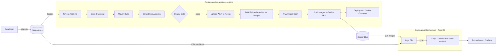
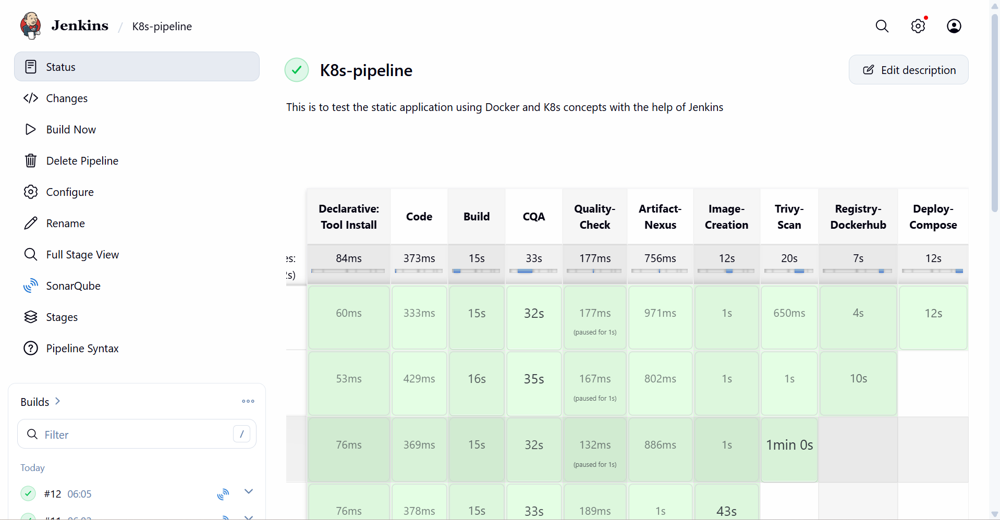
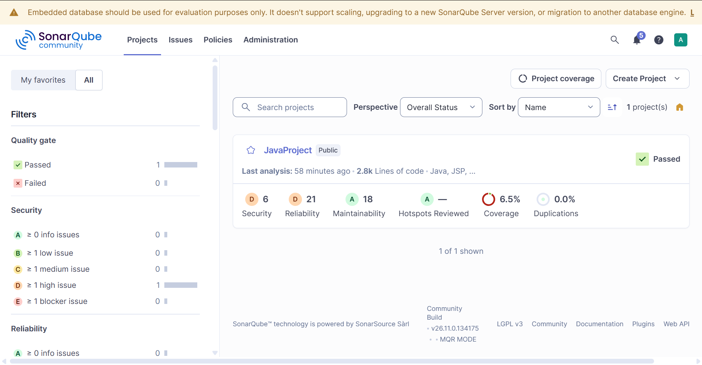
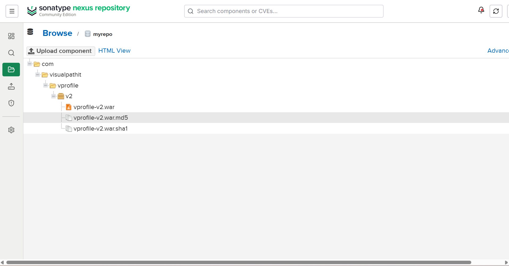
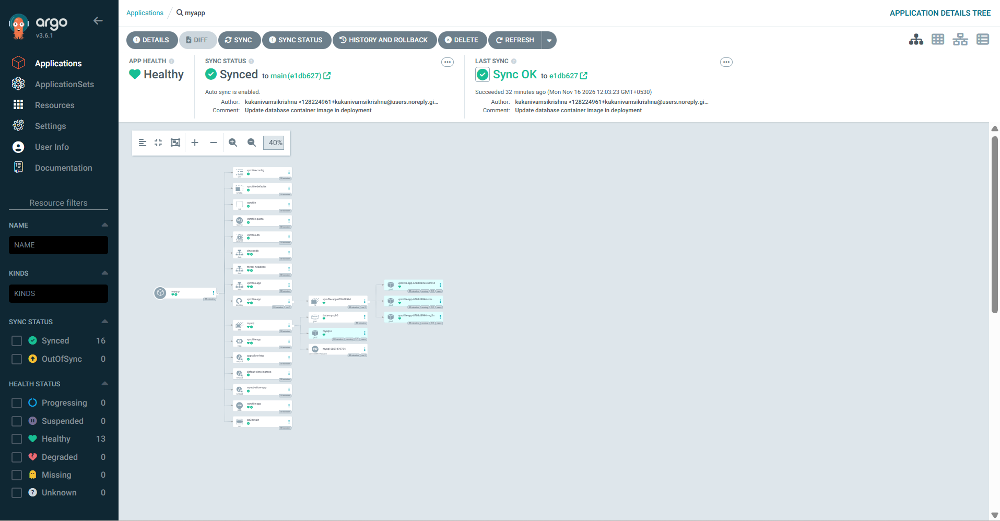
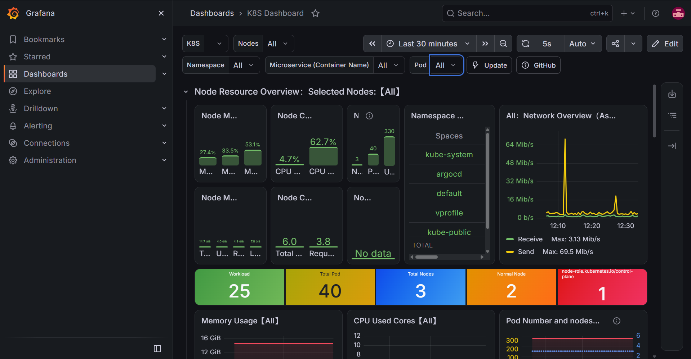

# End-to-End DevOps CI/CD Pipeline on AWS (Jenkins + SonarQube + Nexus + Trivy + Argo CD + Kops + Prometheus/Grafana)

A complete CI/CD project where **Jenkins handles Continuous Integration** (build, code quality, artifact storage, image build, security scan) and **Argo CD handles Continuous Deployment** (GitOps-style delivery) to a **self-managed Kubernetes cluster created with Kops on AWS**. Monitoring is provided by **Prometheus and Grafana**.

> **Source code:** https://github.com/kakanivamsikrishna/docker-webapp-k8s.git

---

## Table of Contents
1. [Architecture & Flow](#architecture--flow)
2. [Tech Stack](#tech-stack)
3. [Infrastructure Layout](#infrastructure-layout)
4. [Pipeline Stages (Jenkins - CI)](#pipeline-stages-jenkins---ci)
5. [Deployment (Argo CD - CD)](#deployment-argo-cd---cd)
6. [Monitoring](#monitoring)
7. [Setup Guide](#setup-guide)
8. [Security Notes & Improvements](#security-notes--improvements)
9. [Screenshots](#screenshots)
10. [Key Learnings](#key-learnings)

---

## Architecture & Flow



**In short:**
1. Developer pushes code to GitHub.
2. Jenkins builds the app with Maven, checks code quality with SonarQube, enforces a Quality Gate, and stores the `.war` artifact in Nexus.
3. Jenkins builds two Docker images (database and application), scans them with Trivy, pushes them to Docker Hub, and brings the stack up with Docker Compose.
4. Argo CD watches the Git repo containing Kubernetes manifests and deploys them to the Kops cluster.
5. Prometheus and Grafana monitor the cluster and application, with dashboards and alerts.

---

## Tech Stack

| Category | Tool |
|---|---|
| Cloud | AWS (EC2, S3) |
| CI Server | Jenkins |
| Build Tool | Maven |
| Code Quality | SonarQube (Docker container) |
| Artifact Repository | Nexus |
| Containerization | Docker, Docker Compose |
| Container Registry | Docker Hub |
| Image Security Scan | Trivy |
| Kubernetes Provisioning | Kops (state stored in S3) |
| CD / GitOps | Argo CD |
| Package Manager (K8s) | Helm |
| Monitoring | Prometheus, Grafana (kube-prometheus-stack), Metrics Server |
| OS | Amazon Linux |

---

## Infrastructure Layout

| Server / Component | Instance Type | Purpose |
|---|---|---|
| Jenkins-Sonar | m7i | Jenkins, Docker, SonarQube, Trivy, Git, kubectl, Kops |
| Nexus Server | c7i | Nexus artifact repository |
| Kops Control Plane (master) | m7i-flex.large (30 GB) | Kubernetes master |
| Kops Worker Nodes (x2) | c7i-flex.large (25 GB each) | Kubernetes workers (Argo CD, app pods, monitoring) |

- **Region / Zones:** us-east-2 (`us-east-2a`, `us-east-2b`)
- **Cluster name:** `vamsi.k8s.local` (gossip-based DNS)
- **Kops state store:** S3 bucket

---

## Pipeline Stages (Jenkins - CI)

| # | Stage | Description |
|---|---|---|
| 1 | **Code** | Pulls the `main` branch from GitHub |
| 2 | **Build** | Compiles and packages the app with Maven (`mvn clean install`) producing a `.war` |
| 3 | **CQA** | Runs SonarQube analysis through the `mysonar` server config (project key: `JavaProject`) |
| 4 | **Quality-Check** | `waitForQualityGate` aborts the pipeline if the Sonar quality gate fails |
| 5 | **Artifact-Nexus** | Reads `pom.xml` and uploads the `.war` to the Nexus3 repository `myrepo` |
| 6 | **Image-Creation** | Builds the database image (`Docker-db`) and the application image (`Dockerfile` at repo root) |
| 7 | **Trivy-Scan** | Scans both images and writes `dbreport.txt` and `appreport.txt` |
| 8 | **Registry-Dockerhub** | Pushes both images to Docker Hub |
| 9 | **Deploy-Compose** | Starts the stack with `docker-compose up -d` |

### Jenkins prerequisites

| Item | Where to configure | Name used in pipeline |
|---|---|---|
| Maven installation | Manage Jenkins > Tools | `mymaven` |
| SonarQube server | Manage Jenkins > System | `mysonar` |
| SonarQube token | Credentials | `SonarQube` |
| Nexus login | Credentials | `nexus` |
| Docker Hub login | Credentials | `Docker-hub` |
| Plugins | Manage Jenkins > Plugins | SonarQube Scanner, Nexus Artifact Uploader, Pipeline Maven Integration, Docker Pipeline |

Also configure a SonarQube webhook pointing to `http://<jenkins-ip>:8080/sonarqube-webhook/` so the quality gate result reaches Jenkins.

### Jenkinsfile

```groovy
pipeline {
    agent any
    tools {
        maven "mymaven"
    }
    stages {
        stage ("Code") {
            steps {
                git branch: 'main', url: 'https://github.com/kakanivamsikrishna/docker-webapp-k8s.git'
            }
        }
        stage ("Build") {
            steps {
                sh "mvn clean install"
            }
        }
        stage ("CQA") {
            steps {
                withSonarQubeEnv("mysonar") {
                    sh "mvn clean verify org.sonarsource.scanner.maven:sonar-maven-plugin:sonar -Dsonar.projectKey=JavaProject -Dsonar.projectName='JavaProject'"
                }
            }
        }
        stage ("Quality-Check") {
            steps {
                waitForQualityGate abortPipeline: true, credentialsId: 'SonarQube'
            }
        }
        stage ("Artifact-Nexus") {
            steps {
                script {
                    def pom = readMavenPom file: 'pom.xml'
                    nexusArtifactUploader artifacts: [[artifactId: pom.artifactId, classifier: '', file: "target/${pom.artifactId}-${pom.version}.war", type: 'war']], credentialsId: 'nexus', groupId: pom.groupId, nexusUrl: '<NEXUS_IP>:8081', nexusVersion: 'nexus3', protocol: 'http', repository: 'myrepo', version: pom.version
                }
            }
        }
        stage ("Image-Creation") {
            steps {
                sh "docker build -t vamsikrishnakakani/k8s-java:dbimage Docker-db"
                sh "docker build -t vamsikrishnakakani/k8s-java:appimage ."
            }
        }
        stage ("Trivy-Scan") {
            steps {
                sh "trivy image vamsikrishnakakani/k8s-java:dbimage >> dbreport.txt"
                sh "trivy image vamsikrishnakakani/k8s-java:appimage >> appreport.txt"
            }
        }
        stage ("Registry-Dockerhub") {
            steps {
                script {
                    withDockerRegistry(credentialsId: 'Docker-hub') {
                        sh "docker push vamsikrishnakakani/k8s-java:dbimage"
                        sh "docker push vamsikrishnakakani/k8s-java:appimage"
                    }
                }
            }
        }
        stage ("Deploy-Compose") {
            steps {
                sh "docker-compose up -d"
            }
        }
    }
}
```

> The Nexus IP is replaced with `<NEXUS_IP>` here on purpose. Avoid publishing real server IPs in a public repo.

---

## Deployment (Argo CD - CD)

- Argo CD is installed in the `argocd` namespace on the Kops cluster.
- The `argocd-server` service is exposed using a **LoadBalancer**.
- Jenkins publishes the images `vamsikrishnakakani/k8s-java:dbimage` and `vamsikrishnakakani/k8s-java:appimage` to Docker Hub; the Kubernetes manifests reference these images.
- Argo CD syncs Kubernetes manifests from Git and deploys the application into the `vprofile` namespace.
- Any change committed to the manifests in Git is automatically reflected in the cluster (GitOps).

---

## Monitoring

- **Metrics Server** installed for `kubectl top` and resource metrics.
- **kube-prometheus-stack** installed with Helm, which includes Prometheus, Grafana and Alertmanager.
- Grafana and Prometheus services are exposed via **LoadBalancer**.
- Grafana dashboards are used to visualize cluster/app health and set up alerts.

---

## Setup Guide

### 1. Jenkins + Docker + Git (Amazon Linux)
```bash
hostnamectl set-hostname Jenkins-Sonar
yum install java-21-amazon-corretto -y

sudo wget -O /etc/yum.repos.d/jenkins.repo https://pkg.jenkins.io/rpm-stable/jenkins.repo
yum install jenkins -y && systemctl enable --now jenkins

yum install docker -y && systemctl enable --now docker
yum install git -y

systemctl status jenkins
systemctl status docker

# Initial Jenkins admin password
cat /var/lib/jenkins/secrets/initialAdminPassword
```
Access Jenkins at `http://<server-ip>:8080`.

### 2. SonarQube (Docker)
```bash
docker run -d --name sonar -p 9000:9000 sonarqube
docker ps
```
Access SonarQube at `http://<server-ip>:9000`.

### 3. Nexus
Launch a separate EC2 server (c7i), install Nexus, and create a repository for the `.war` artifacts. Add the Nexus details to the Jenkins pipeline.

### 4. Trivy
```bash
curl -sfL https://raw.githubusercontent.com/aquasecurity/trivy/main/contrib/install.sh | sudo sh -s -- -b /usr/local/bin v0.76.2
trivy image <image-name>
```

### 5. Docker Compose
```bash
sudo mkdir -p /usr/libexec/docker/cli-plugins
sudo curl -SL "https://github.com/docker/compose/releases/latest/download/docker-compose-$(uname -s)-$(uname -m)" -o /usr/local/bin/docker-compose
sudo chmod +x /usr/local/bin/docker-compose
sudo ln -s /usr/local/bin/docker-compose /usr/bin/docker-compose
docker-compose version
```

### 6. kubectl and Kops
```bash
curl -LO "https://dl.k8s.io/release/$(curl -L -s https://dl.k8s.io/release/stable.txt)/bin/linux/amd64/kubectl"
chmod +x kubectl && mv kubectl /usr/local/bin/

curl -Lo kops https://github.com/kubernetes/kops/releases/download/$(curl -s https://api.github.com/repos/kubernetes/kops/releases/latest | grep tag_name | cut -d '"' -f 4)/kops-linux-amd64
chmod +x kops && sudo mv kops /usr/local/bin/kops
```

### 7. Create the Kubernetes Cluster with Kops
```bash
export KOPS_STATE_STORE=s3://<your-bucket-name>

kops create cluster --name vamsi.k8s.local \
  --zones us-east-2a,us-east-2b \
  --master-count 1 --master-size m7i-flex.large --master-volume-size 30 \
  --node-count 2 --node-size c7i-flex.large --node-volume-size 25 \
  --image=<ami-id>

kops update cluster --name vamsi.k8s.local --yes --admin
kubectl get nodes
```

### 8. Install Argo CD
```bash
kubectl create namespace argocd
kubectl apply -n argocd -f https://raw.githubusercontent.com/argoproj/argo-cd/stable/manifests/install.yaml
kubectl get all -n argocd

# Expose Argo CD
kubectl patch svc argocd-server -n argocd -p '{"spec": {"type": "LoadBalancer"}}'
kubectl get svc -n argocd

# Get initial admin password (username: admin)
kubectl -n argocd get secret argocd-initial-admin-secret -o jsonpath="{.data.password}" | base64 -d
```

### 9. Metrics Server
```bash
kubectl apply -f https://github.com/kubernetes-sigs/metrics-server/releases/latest/download/components.yaml
kubectl top po -n argocd
```

### 10. Helm + Prometheus + Grafana
```bash
curl -fsSL -o get_helm.sh https://raw.githubusercontent.com/helm/helm/main/scripts/get-helm-3
chmod 700 get_helm.sh && ./get_helm.sh
helm version

helm install prometheus oci://ghcr.io/prometheus-community/charts/kube-prometheus-stack

# Expose Grafana and Prometheus
kubectl patch svc prometheus-grafana -p '{"spec":{"type":"LoadBalancer"}}'
kubectl patch svc prometheus-kube-prometheus-prometheus -p '{"spec":{"type":"LoadBalancer"}}'
kubectl get svc

# Grafana admin password (username: admin)
kubectl --namespace default get secrets prometheus-grafana -o jsonpath="{.data.admin-password}" | base64 -d ; echo
```

### 11. Verify the Application
```bash
kubectl get po -n vprofile
```

---

## Security Notes & Improvements

This is a learning/demo setup. For production, consider:

- ⚠️ **Avoid `chmod 777 /var/run/docker.sock`.** Instead add the Jenkins user to the docker group:
  `sudo usermod -aG docker jenkins && sudo systemctl restart jenkins`
- Restrict security group ports (8080, 9000, Nexus port) to trusted IPs only instead of `0.0.0.0/0`.
- Trivy currently only writes reports (`>> dbreport.txt`). To fail the build on serious findings, use `trivy image --exit-code 1 --severity HIGH,CRITICAL <image>`, and archive the reports with `archiveArtifacts`.
- Use unique image tags (for example `${BUILD_NUMBER}` or the Git commit) instead of fixed tags like `dbimage` and `appimage`, so Argo CD can detect new versions and you can roll back.
- Use `>` instead of `>>` for Trivy reports, otherwise each build appends to the old report.
- Do not use `latest` tags for Docker Compose / Metrics Server; pin versions.
- Store credentials (Nexus, SonarQube token, registry) in **Jenkins Credentials**, never in the Jenkinsfile.
- Put Argo CD, Grafana and Prometheus behind an Ingress with TLS and authentication instead of public LoadBalancers.
- Change the default Argo CD and Grafana admin passwords after the first login.
- Delete cluster resources when done to avoid AWS charges:
  ```bash
  kops delete cluster --name vamsi.k8s.local --yes
  ```

---

## Screenshots

### Jenkins CI Pipeline
All 9 stages (Code, Build, CQA, Quality-Check, Artifact-Nexus, Image-Creation, Trivy-Scan, Registry-Dockerhub, Deploy-Compose) completing successfully.



### SonarQube Code Quality
`JavaProject` analysed by SonarQube, with the Quality Gate **Passed**.



### Nexus Artifact Repository
The `vprofile-v2.war` artifact uploaded by Jenkins into the `myrepo` repository.



### Argo CD Deployment
The `myapp` application **Synced** and **Healthy** with auto-sync enabled. Argo CD deploys the manifests from the `main` branch to the Kops cluster.



### Grafana Monitoring
Kubernetes dashboard showing the 3 nodes (1 control plane, 2 workers), 40 pods and the `argocd` and `vprofile` namespaces.



---

## Key Learnings

- Built a full CI pipeline with quality and security gates (SonarQube + Trivy).
- Managed build artifacts using Nexus.
- Provisioned a production-style Kubernetes cluster on AWS with Kops.
- Implemented GitOps-based continuous deployment with Argo CD.
- Set up observability using Prometheus and Grafana.

---

## Author

**Vamsi Krishna Kakani**
GitHub: [@kakanivamsikrishna](https://github.com/kakanivamsikrishna)
